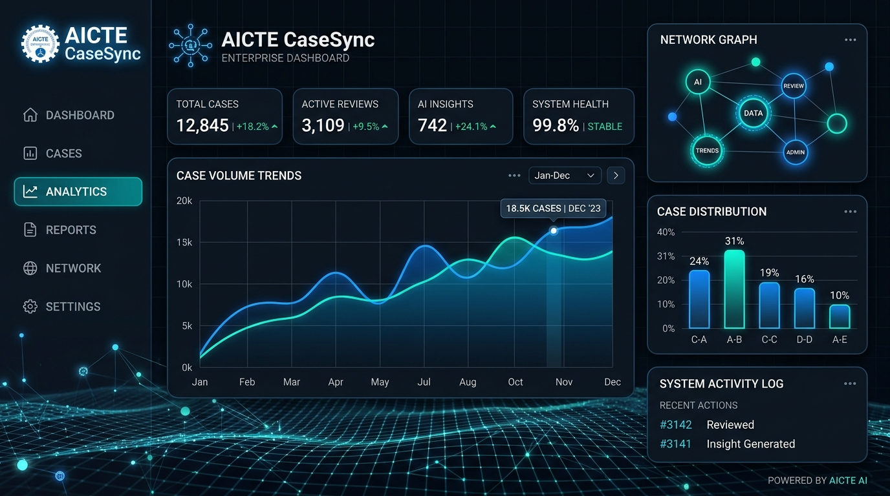
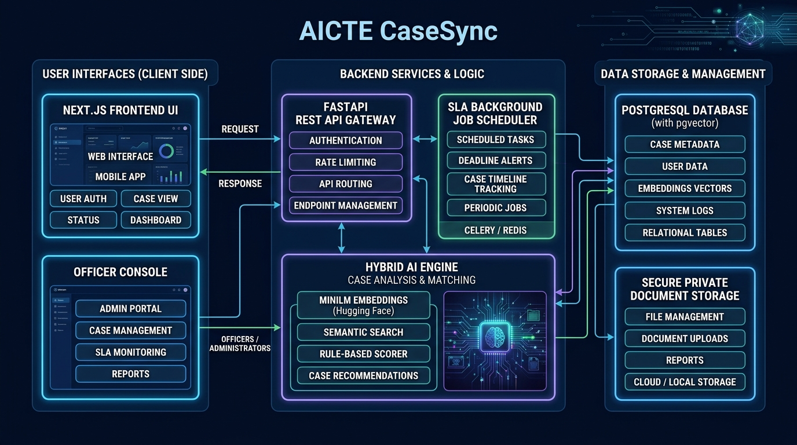
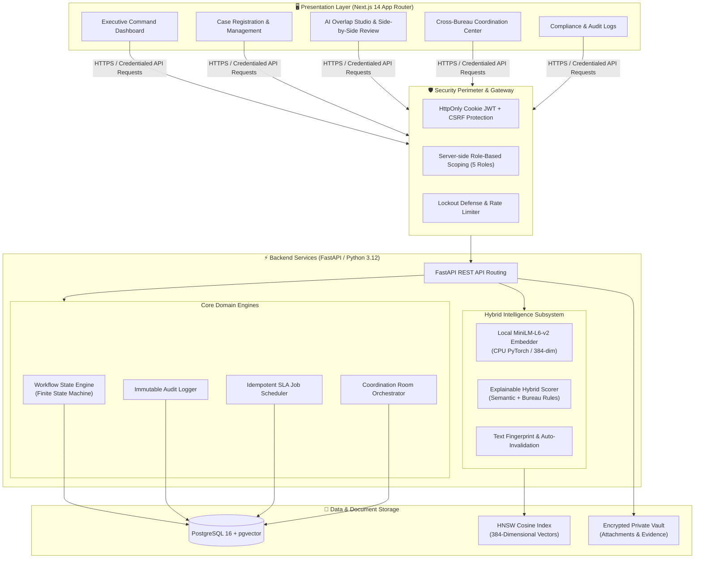
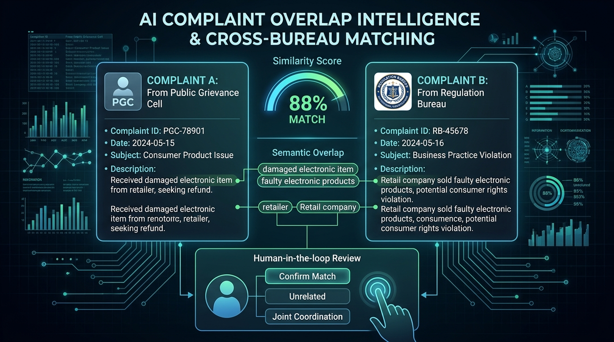
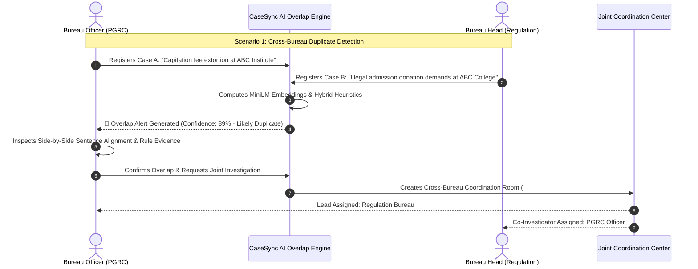
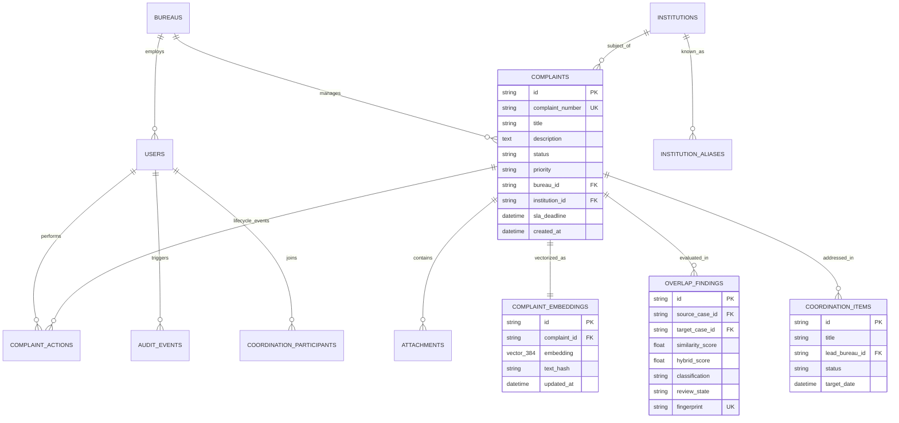

<div align="center">

# 🏛️ AICTE CaseSync
### Intelligent Cross-Bureau Complaint Monitoring, AI Overlap Detection & Coordination Platform
**Smart India Hackathon (SIH) | Problem ID: SIH26264**

[](https://www.python.org/)
[](https://fastapi.tiangolo.com/)
[](https://nextjs.org/)
[](https://github.com/pgvector/pgvector)
[](https://huggingface.co/sentence-transformers/all-MiniLM-L6-v2)
[](https://www.docker.com/)

<br />



<p align="center">
  <b>A unified, auditable command console that eliminates institutional blindspots, detects duplicate complaints across regulatory bureaus using hybrid AI, enforces strict SLAs, and automates multi-agency coordination.</b>
</p>

[System Architecture](#-system-architecture) •
[AI Overlap Engine](#-ai-overlap-intelligence-engine) •
[Tech Stack](#-complete-technology-stack) •
[Core Modules](#-core-platform-modules) •
[Interactive Demo](#-interactive-demonstration-scenarios) •
[Quick Start](#-quick-start--installation)

---

</div>

> **⚖️ Data Notice:** AICTE supplied no official dataset, private complaint history, or internal credentials. Every seeded institution, official, and complaint is a deterministic, synthetic record clearly labeled in the database and UI. CaseSync does not claim official AICTE deployment or endorsement.

---

## 📌 Executive Summary & Problem Context

The **All India Council for Technical Education (AICTE)** oversees thousands of technical colleges and universities across India. Public and institutional grievances are channeled through multiple distinct specialized bureaus:
- **PGRC** (Public Grievance Redressal Cell)
- **RB** (Regulation Bureau)
- **AB** (Approval Bureau)
- **SWC** (Student Welfare Cell)

### The Challenge
1. **Isolated Bureau Silos**: Multiple bureaus often independently investigate duplicate, paraphrased, or related grievances filed against the same college by different stakeholders (students, faculty, parents).
2. **Administrative Duplication & Inconsistent Decisions**: Bureaus waste valuable investigator hours and risk reaching conflicting conclusions on related matters.
3. **Escalation Gaps & SLA Breaches**: Grievances stall without real-time cross-departmental visibility and automated escalation.
4. **Lack of Canonical Institution Intelligence**: Varied spellings, aliases, or unverified permanent IDs make it difficult to aggregate historical track records.

### The Solution: CaseSync
**AICTE CaseSync** acts as an intelligent operational nervous system. It canonicalizes institutional identities, computes 384-dimensional dense semantic embeddings with **Sentence Transformers (`all-MiniLM-L6-v2`)**, calculates transparent hybrid overlap scores, alerts officers in real-time, facilitates joint cross-bureau coordination rooms, and enforces automated, auditable SLA lifecycles.

---

## 🏛️ System Architecture



CaseSync is built upon a decoupled, secure, and production-ready micro-monolith architecture designed for high throughput, auditable data persistence, and zero cloud data leaks.

### Architectural Flowchart



### Architectural Highlights
- **Zero Cloud Data Egress**: All NLP embeddings run locally via CPU-optimized PyTorch. Complaint text and sensitive investigator notes never leave the local boundary.
- **Transactional Integrity**: Material case transitions, cross-bureau transfers, and audit logs execute within unified database transactions.
- **Graceful AI Degradation**: If PyTorch or model weights are missing, CaseSync automatically activates a deterministic `feature-hash-fallback` mode so case management workflows never crash.

---

## 🧠 AI Overlap Intelligence Engine



CaseSync features a purpose-built, explainable overlap engine combining transformer-based deep semantic text comparison with deterministic administrative heuristic signals.

### 1. Hybrid Scoring Formula
Rather than trusting opaque neural network outputs as legal decisions, CaseSync balances NLP semantics with regulatory reality:

$$\text{Final Overlap Score} = w_s \cdot S_{\text{semantic}} + w_i \cdot I_{\text{canonical}} + w_c \cdot C_{\text{category}} + w_b \cdot B_{\text{bureau}} + w_a \cdot A_{\text{active}}$$

| Feature | Weight ($w$) | Description |
|---|:---:|---|
| **Semantic Similarity** ($S_{\text{semantic}}$) | **62%** | Cosine similarity of 384-dimensional dense vectors generated by `all-MiniLM-L6-v2`. |
| **Canonical Institution** ($I_{\text{canonical}}$) | **18%** | Verification of identical canonical college ID (resolving aliases & typos). |
| **Category Overlap** ($C_{\text{category}}$) | **8%** | Shared complaint domain (e.g., fee extortion, faculty irregularities, infrastructure fraud). |
| **Cross-Bureau Ownership** ($B_{\text{bureau}}$) | **7%** | Presence of complaints across disparate bureau jurisdictions. |
| **Concurrent Active State** ($A_{\text{active}}$) | **5%** | Both cases are currently pending, under process, or escalated. |

### 2. Decision Classifications
- **`likely_duplicate` ($\ge 0.82$)**: Almost identical issues or paraphrased grievances. Alerts officers to avoid split investigations.
- **`cross_bureau_related` ($0.55 - 0.81$)**: Correlated misconduct indicating systemic issues at an institution across different mandates.
- **`shared_institution_activity` ($0.42 - 0.54$)**: Advisory signal that an institution has multiple concurrent complaints without claiming subject matter duplication.

### 3. Human-in-the-Loop & Fingerprint Invalidation
- **Transparent Evidence**: Side-by-side keyword overlap, sentence alignment, and confidence scores are presented directly to officers.
- **Official Actions**: Case Officers can **Confirm Overlap**, **Reject**, or mark as **Unrelated**.
- **Cryptographic Fingerprinting**: Decisions are tied to SHA-256 hashes of both complaint texts. If either complaint is materially amended, the suppression state is invalidated and re-evaluated.

---

## 🛠️ Complete Technology Stack

| Layer | Technology | Purpose & Implementation |
|---|---|---|
| **Frontend Framework** | **Next.js 14** (App Router) | High-performance React framework with server-side rendered entry and client-side dynamic views. |
| **Language & Types** | **TypeScript 5.x** | End-to-end typed contracts between API schemas and frontend components. |
| **Styling & Design** | **Tailwind CSS + Lucide Icons** | Custom high-density enterprise console with accessible color scales and dark mode aesthetics. |
| **Backend Framework** | **FastAPI** (Python 3.12) | High-speed asynchronous Python REST API with automatic OpenAPI documentation. |
| **Database ORM** | **SQLAlchemy 2.0** | Fully typed mapped entities, explicit session handling, and transactional consistency. |
| **Database & Vectors** | **PostgreSQL 16 + pgvector** | Production relational storage with native 384-dim HNSW vector cosine indexing. |
| **Dev Database** | **SQLite 3** (Dialect-aware) | Frictionless, zero-install local Windows development mode with JSON vector simulation. |
| **Database Migrations** | **Alembic** | Version-controlled, reproducible schema migrations and rollback capabilities. |
| **AI / NLP Model** | **Sentence Transformers (MiniLM-L6-v2)** | 384-dimensional dense text representations; CPU-optimized, offline-cached inference. |
| **Security & Auth** | **Bcrypt + JWT + Double CSRF** | HttpOnly SameSite cookies, bcrypt cost-factor 12, CSRF token header validation, and brute-force lockout. |
| **Job Scheduling** | **Python Asyncio / Scheduler** | Idempotent background scanner evaluating SLAs, deadlines, and notifications every hour. |
| **Testing Suites** | **Pytest + Vitest + Playwright** | Full-stack unit tests, ML threshold sweeps, and automated browser E2E user journeys. |
| **Containerization** | **Docker & Docker Compose** | Multi-container setup with healthchecks, persistent volumes, and isolated networking. |

---

## 🧩 Core Platform Modules

```text
SIH-CaseSync/
├── frontend/                     # Next.js App Router Operations Console
│   ├── app/                      # Dynamic catch-all application routes & layout
│   ├── components/               # Enterprise Console, Overlap Studio, Demo Center
│   │   ├── casesync-app.tsx      # Main operational console & navigation
│   │   ├── demo-center.tsx       # Interactive proof scenarios & state simulator
│   │   └── enhancements.tsx      # Analytical visualizations, tables, & filters
│   ├── lib/                      # Secure API client, CSRF interceptor, types
│   └── e2e/                      # Playwright E2E scenario test journeys
├── backend/                      # FastAPI Python Application
│   ├── app/
│   │   ├── api/                  # REST endpoints (auth, cases, overlaps, reports)
│   │   ├── core/                 # Config, DB connection, JWT/RBAC security
│   │   ├── ml/                   # MiniLM-L6-v2 embedding & hybrid overlap engine
│   │   ├── models/               # SQLAlchemy domain entities & constraints
│   │   ├── schemas/              # Pydantic validation contracts
│   │   ├── services/             # Finite workflow, SLA escalation, coordination
│   │   └── seed.py               # Deterministic seed generator (100 orgs, 1,000 cases)
│   └── alembic/                  # Versioned database migrations
└── docs/                         # Architecture, AI Engine specs, and demo scripts
```

### Module Highlights

| Module | Core Responsibility |
|---|---|
| **Overview & Action Hub** | Real-time bureau health, urgent action items, SLA countdown timers, and caseload volume charts. |
| **Interactive Demo Center** | Deterministic showcase center with 3 scripted scenarios proving AI accuracy and workflow transitions. |
| **Canonical Institution Registry** | Searchable database of 100+ colleges with AICTE Permanent IDs, aliases, accreditation status, and CSV intake. |
| **Complaint Lifecycle Manager** | End-to-end case processing: Intake $\rightarrow$ Assignment $\rightarrow$ Transfer $\rightarrow$ Escalation $\rightarrow$ Disposal $\rightarrow$ Reopening. |
| **AI Overlap Studio** | Interactive ranked review table with deep similarity scores, evidence breakdown, and side-by-side textdiff. |
| **Coordination Center** | Joint taskforces for cross-bureau cases: multi-bureau participants, accountable task items, and shared deadlines. |
| **My Work Queue** | Personalized, bureau-scoped action lists prioritizing impending SLA breaches and pending reviews. |
| **Audit & Governance** | Append-only audit records logging the actor, timestamp, IP, entity ID, and exact state transition diff. |
| **Reports & Export** | Dynamic aggregated analytics with one-click export to filtered CSV and standardized executive PDF reports. |

---

## 🎬 Interactive Demonstration Scenarios

CaseSync includes a built-in **Interactive Demo Center** located at `/demo`. Each scenario is deterministic at input to ensure repeatability for evaluators, while executed by live backend services:



### Scripted Scenarios:
1. **AI Detects Duplicate Investigations**:
   - Paraphrased complaints filed across PGRC and Regulation Bureau for the same college.
   - Real MiniLM embedding inference flags an 89% overlap; officers inspect side-by-side evidence and spawn a joint coordination workspace.
2. **Same Institution, Different Complaints (False-Positive Control)**:
   - Proves that sharing an institution does not trigger false alarms. A complaint regarding *mess food hygiene* and another regarding *unapproved course additions* are recognized as distinct and suppressed without administrative disruption.
3. **SLA Breach & Automatic Escalation**:
   - Demonstrates a critical grievance exceeding its 7-day resolution window. Case status shifts from `Under Process` $\rightarrow$ `Escalated`, notifying the Central Administrator and appending to the audit trail.

---

## ⚡ Quick Start & Installation

### Option 1: Run with Docker (Recommended)

Requires **Docker Desktop** with Compose support:

```powershell
# 1. Clone repository
git clone https://github.com/Vatsal212005/SIH-CaseSync.git
cd SIH-CaseSync

# 2. Configure environment
Copy-Item .env.example .env

# 3. Build and launch containers
docker compose up --build
```

- **Operations Console**: [http://localhost:3000](http://localhost:3000)
- **FastAPI OpenAPI Docs**: [http://localhost:8000/docs](http://localhost:8000/docs)
- **AI Engine Health Diagnostic**: [http://localhost:8000/api/v1/health](http://localhost:8000/api/v1/health)

---

### Option 2: Native Windows 11 Local Setup

Requires **Python 3.12**, **Node.js 20+**, and **PowerShell 5.1+**:

```powershell
# 1. Setup Backend Virtual Environment
py -3.12 -m venv backend\.venv
backend\.venv\Scripts\python.exe -m pip install --upgrade pip
backend\.venv\Scripts\python.exe -m pip install -r backend\requirements.txt

# 2. Setup Frontend Dependencies
Push-Location frontend
npm ci
Pop-Location

# 3. Cache the MiniLM Transformer Model (Offline Execution)
backend\.venv\Scripts\python.exe -c "from sentence_transformers import SentenceTransformer; SentenceTransformer('sentence-transformers/all-MiniLM-L6-v2')"

# 4. Launch Full Stack with Diagnostics
powershell.exe -NoProfile -ExecutionPolicy Bypass -File .\start-dev.ps1 -OpenBrave
```

To stop all recorded background processes cleanly:
```powershell
powershell.exe -NoProfile -ExecutionPolicy Bypass -File .\stop-dev.ps1
```

---

## 🔑 Demonstration Accounts

When `DEMO_MODE=true` is enabled, the database is deterministically seeded with pre-configured accounts:

| Role | Email Address | Default Password | Scoped Permissions |
|---|---|:---:|---|
| **System Administrator** | `admin@casesync.demo` | `CaseSync@2026` | Full platform settings, thresholds, user management. |
| **Central Administrator** | `central@casesync.demo` | `CaseSync@2026` | All-bureau oversight, master reassignments, global analytics. |
| **Bureau Head (RB)** | `head.rb@casesync.demo` | `CaseSync@2026` | Regulation Bureau queue, officer assignment, transfers. |
| **Case Officer (RB)** | `officer1.rb@casesync.demo` | `CaseSync@2026` | Assigned investigation workflows, remarks, disposals. |
| **Auditor** | `auditor@casesync.demo` | `CaseSync@2026` | Strictly read-only access to all complaints & immutable logs. |

*(Equivalent Bureau Head and Officer accounts exist for `pgrc`, `ab`, and `swc`)*

---

## 📊 Comprehensive Database Schema

CaseSync enforces referential integrity through SQLAlchemy 2.0 and Alembic migrations:



---

## 🧪 Testing & Verification Suite

CaseSync includes a comprehensive test suite across every tier of the application:

```powershell
# 1. Backend Linting & Unit / Integration Tests
cd backend
python -m ruff check app
python -m pytest --cov=app

# 2. Evaluate ML Overlap Engine with 120-Pair Sweep
python -m app.ml.evaluate --sweep

# 3. Frontend Unit & Type Tests
cd ../frontend
npm run lint
npm run typecheck
npm test

# 4. Playwright End-to-End User Journeys
npx playwright install chromium
npm run test:e2e
```

### 120-Pair Evaluation Benchmark Results
As recorded in [`docs/evaluation-results.json`](file:///c:/Users/Admin/Pictures/casesync/docs/evaluation-results.json), evaluating `sentence-transformers/all-MiniLM-L6-v2` at the operational threshold $0.55$:
- **Precision**: `1.0000` (Zero false positives in testing matrix)
- **Recall**: `0.8667`
- **F1 Score**: `0.9286`
- **Inference Speed**: `< 45ms` per complaint pair on standard CPU.

---

## 🔒 Security & Defensive Engineering

1. **HttpOnly & SameSite Cookie Session Management**: Access tokens cannot be harvested via cross-site scripting (XSS).
2. **Strict CSRF Double-Submit Protection**: Mutations require both the authenticated session and a matching cryptographic `X-CSRF-Token` header.
3. **Server-Side RBAC Scoping**: Bureau heads and officers cannot query or mutate cases outside their assigned bureau ID at the database level.
4. **Brute-Force Lockout Defense**: 5 consecutive failed login attempts trigger an automated account lockout window.
5. **Private Attachment Vault**: Uploaded PDFs and images are SHA-256 hashed, stored outside public web roots with sanitized filenames, and streamed only after case-scope verification.
6. **Masked Structured Logs**: Passwords, cryptographic tokens, and raw complaint narrative texts are excluded from stdout/JSON log streams.

---

## 📄 License & Attribution

Developed for **Smart India Hackathon (SIH)** under Problem Statement **SIH26264**.  
Built with ❤️ by Team CaseSync.
